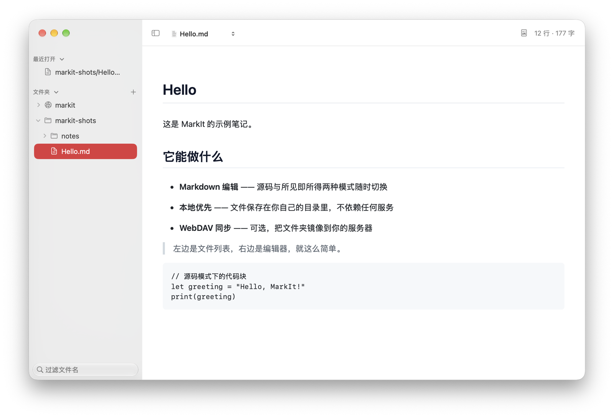
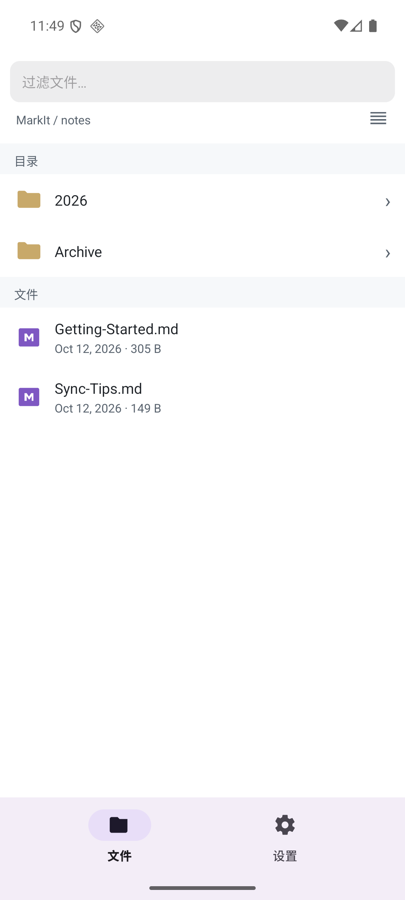
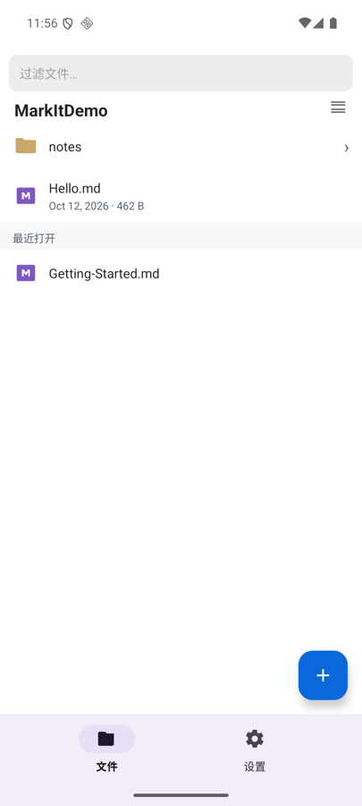
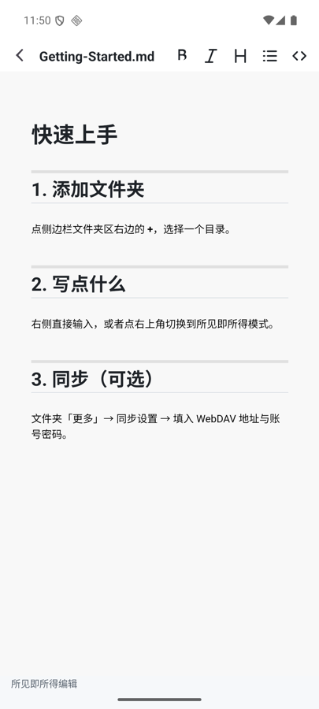

# MarkIt

本地优先的 Markdown 笔记应用。文件存在你自己的目录里，同步是可选的镜像，不是依赖。

## 它是什么

一个离线可用的 Markdown 编辑器：源码和所见即所得两种模式，随时切换。左边是文件树，右边是编辑器。没有账号，没有云端，没有网络也能用。

WebDAV 同步是加上去的，不是必需的。不配同步，它就是一个纯本地应用；配了，同步也只是单向镜像到你的服务器。

## 两个平台

macOS 和 Android 是同一个应用的两份实现，同一份文件格式，同一个同步逻辑。

macOS 是文件树加编辑器分栏，`Cmd+S` 立即保存并同步：



Android 是单栏，列表进编辑器。默认按目录分组，面包屑右边的图标切到平铺，也就是文件夹和文件混在一起。进子目录和退回根目录各自独立，切过的状态不会带到下一层：



平铺模式，标题栏是选中的目录名：



打开笔记直接进所见即所得，源码是同一个页面里的一个开关，不是另一个页面。改 Markdown 和看渲染结果本来就是看同一篇文档的两种方式，不该为此多一个页面：



## 设计上的几个选择

**本地是唯一真值。** 同步失败、网络断开、服务器不可达——都不会影响本地文件。WebDAV 是镜像，本地才是源。网络失败不能覆盖本地内容。

**文件夹是身份，不是名字。** 两个目录里各有一个 `drafts`，它们互不相干：不同的同步配置、不同的密码、不同的 manifest。切换存储目录不会删除原目录的任何东西，同步关系只是暂停，切回来自动恢复。

**密码加密存储。** WebDAV 密码用 AES-256-GCM 加密后存在本地，密钥绑定设备硬件特征。

**待同步状态是诚实的。** 侧边栏的橙色云朵表示「本地有改动还没上传」。它只在真正上传完成后才消失——不会假装成功。失败了会变成红色三角，不是假装没事。

## 自动同步

停止输入 **30 秒**后自动同步。手动保存（`Cmd+S`）会立刻触发一次，走的是和定时器到期完全相同的逻辑。

macOS 和 Android 用同一个窗口。它们连同一批 WebDAV 服务器，同一篇笔记在两个平台轮流编辑是常事，两个不同的时间窗会让同一个改动在相隔几分钟内上传两次。

## 构建

macOS：

```sh
./build.sh
MARKIT_DEST=/tmp/out MARKIT_OPEN=0 ./build.sh    # 装到别处，不自动打开
MARKIT_KEEP_DSYM=1 ./build.sh                     # 额外导出 dSYM
```

Android：

```sh
cd android
./gradlew installDebug
```

## 发布

GitHub Actions 一次构建两个平台的包：

```sh
git tag 0.5.0 && git push origin 0.5.0
gh workflow run markit-release.yml -f tag=0.5.0 -f beta=false
```

推 tag 只是标记版本，构建要手动触发：workflow 只监听 `workflow_dispatch`，没有监听 tag push。

一个 release 里三个文件：

| 文件 | 给谁 |
|---|---|
| `MarkIt-<版本>.zip` | macOS 用户，解压后把 `Markit.app` 拖进「应用程序」|
| `MarkIt-<版本>.apk` | Android 用户，安装需允许「未知来源」|
| `MarkIt-<版本>-dSYM.zip` | 排查崩溃时才需要 |

dSYM 是崩溃符号表。崩溃日志里只有 UUID 和加载地址，要还原成源码行号必须配对「那个构建」的符号表——所以它带版本号，和 app 在同一个 release 里。

## 状态

macOS 和 Android 都可用。Android 侧较新，macOS 侧更完整。

macOS Release 用 ad-hoc 签名，没有 Apple Developer 公证。第一次打开可能需要右键 → 打开。